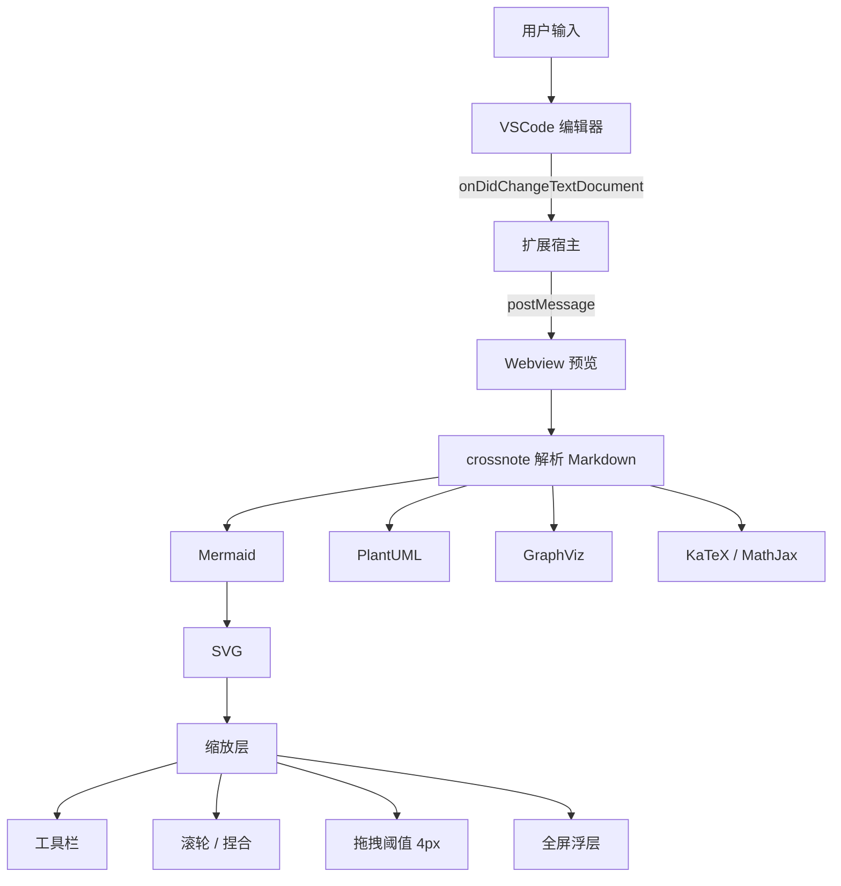
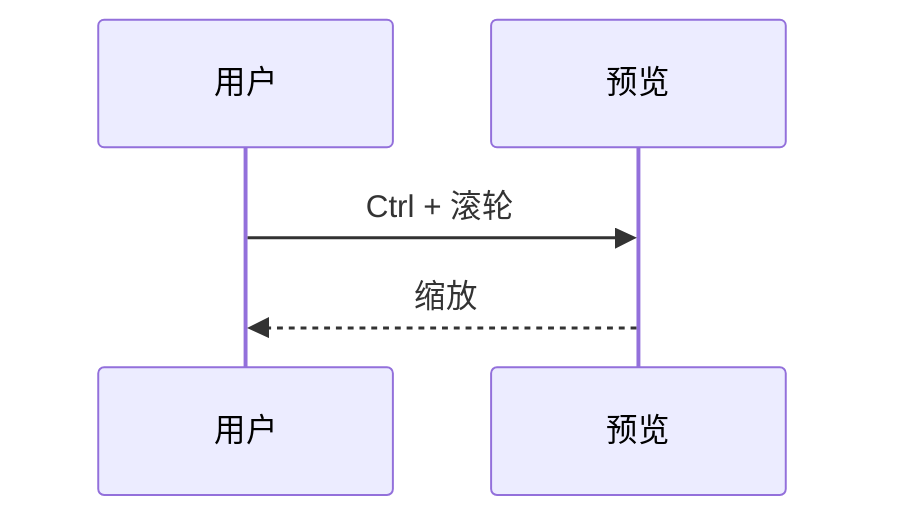
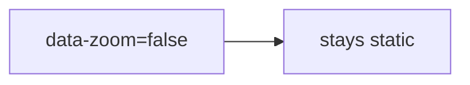

# Mermaid Zoom Test

Hover a diagram to show its toolbar. Requires `markdown-preview-enhanced.enableMermaidZoom` (default `true`).

Check:

- A plain mouse wheel over a diagram scrolls the page; the diagram does not zoom.
- Ctrl/Cmd + wheel (or trackpad pinch) over a diagram zooms it around the cursor; outside a diagram it still zooms the whole preview.
- The diagram keeps its height while zoomed, so the text below does not move.
- Dragging pans the diagram. A press that moves less than 4px is still a click, and releasing a drag over the link node (`缩放层`) does not open the link.
- Double-clicking empty space, or clicking the percentage, resets to 100%.
- Editing a label in diagram 1 re-renders it with the same zoom and position.
- Fullscreen: wheel zooms without a modifier; `+` `-` `0` `F` and the arrow keys work; Escape closes and returns focus to the fullscreen button.
- Diagram 3 (`{data-zoom=false}`) has no toolbar and does not zoom.

## 1. Large flowchart (with a link)

## 2. Sequence diagram

## 3. Opted out with `{data-zoom=false}`

Filler text so the page can scroll.

Filler text so the page can scroll.

Filler text so the page can scroll.
